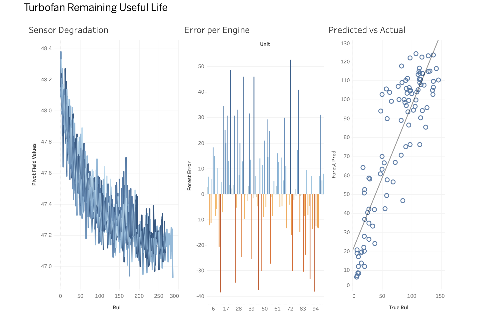

# Predicting Turbofan Engine Remaining Useful Life

I built this to practise the kind of work a performance and reliability
analyst does: take messy sensor data from an engine, work out which signals
matter, and turn that into something a non-specialist can act on.

**Dashboard:** https://public.tableau.com/views/TurbofanRemainingUsefulLife/Dashboard1?:language=en-US&publish=yes&:sid=&:redirect=auth&:display_count=n&:origin=viz_share_link

## The question
Can we predict how many cycles an engine has left before it fails, using
only its sensor readings?

## Data
NASA C-MAPSS, subset FD001: 100 simulated run-to-failure engines for
training and 100 for testing, with 21 sensors each. The data is simulated
and the sensors are unlabelled, so I cannot say what physical quantity each
one measures.

## What I did
1. Loaded the raw text files with pandas and built a SQLite database.
2. Used a SQL window function to work out remaining life for every training
   row, as the engine's final cycle minus the current cycle.
3. Explored the sensors with small multiples. 7 sensors were constant or
   nearly constant, so I dropped them.
4. Tested the remaining 14 sensors by comparing early life (more than 100
   cycles left) with late life (30 cycles or fewer left), using Spearman
   correlation, the Mann-Whitney U test and Cohen's d.
5. Trained a linear regression baseline and then a random forest, capping
   remaining life at 125 cycles for training.
6. Built a Tableau dashboard of the results.

## Findings
- Twelve of the 14 usable sensors showed a large drift before failure
  (Cohen's d above 2). s_11 and s_4 were the strongest.
- Random forest RMSE was 19.9 cycles, against 22.9 for linear regression
  and 43.1 for always guessing the average. That is about 54% less error
  than guessing, and 13% less than the linear baseline.
- The forest leaned heavily on s_11, which carried about 64% of the
  importance. s_4 added about 12%, and the top five sensors together
  covered about 86%. In practice the model is mostly reading one sensor
  and using a few others to fine tune.
- The sensors are unlabelled, so I cannot say what s_11 physically
  measures. Finding that out would be the first thing I would do with real
  engine data.

## Limitations
- The p-values from the statistical tests were all 0.0 because there are
  thousands of rows, and rows from the same engine are not independent. I
  relied on effect sizes instead.
- The gap between the forest (19.9) and linear regression (22.9) is only 3
  cycles, on 100 test engines from a single run. I did not test whether
  that gap is statistically meaningful, so I would not claim the forest is
  clearly better.
- Feature importance from a random forest can split credit unevenly between
  correlated sensors, so s_11 looking dominant may partly reflect that.
- The data is simulated and covers one operating condition. Real engines
  will be noisier.
- I evaluated on one row per test engine, so the RMSE rests on only 100
  predictions.
- Capping remaining life at 125 cycles is a common convention. I did not
  tune it.

## Next steps
Extend to FD002 to FD004, which have several operating conditions and fault
types, and try a model that uses a window of recent cycles instead of a
single row.

## Run it yourself
Download the C-MAPSS turbofan dataset from the NASA Prognostics Data
Repository and put the files in `data/raw/`. Then:

    python -m venv venv
    source venv/bin/activate
    pip install -r requirements.txt
    python src/build_db.py
    python src/eda.py
    python src/stats_analysis.py
    python src/baseline_model.py
    python src/final_model.py

## Project layout
- `src/` the scripts, in the order above
- `charts/` the figures, including the dashboard screenshot
- `data/processed/` the exported CSVs that feed the dashboard